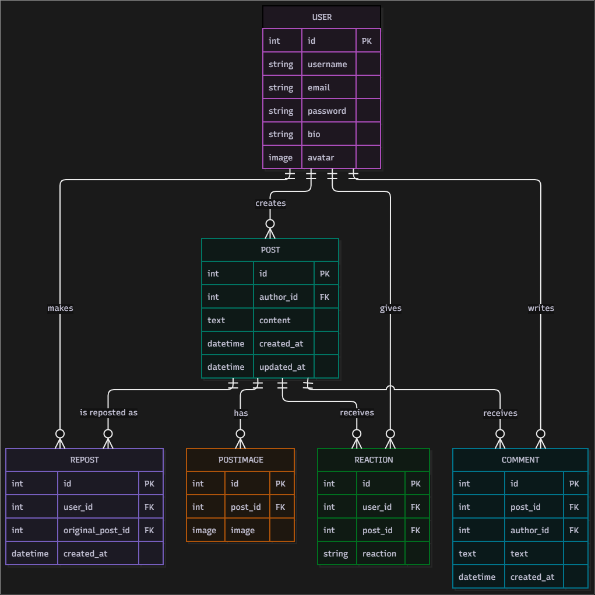

## Social Feed — Custom Portfolio Project
Link to Website
https://olimp-social-feed.onrender.com

A Django-based social media feed application (Instagram/Reddit-style), 
built as a custom portfolio project following the same architecture 
principles as the Taxi Service project (MVT, CBV, auth, forms, search, tests).

### Core features

- **Custom User model** (`AbstractUser`) with `bio` and `avatar` fields
- **Posts** with text content and multiple images per post
- **Comments** on posts, with custom length validation (max 280 characters)
- **Likes / Dislikes** — single-reaction toggle system (one reaction per 
  user per post, switching between like/dislike, or removing the reaction entirely)
- **Reposts** — toggle system to repost/un-repost another user's post
- **User registration** with email and bio fields, built on top of 
  Django's built-in `UserCreationForm`
- **Login / Logout** via Django's built-in authentication views
- **Edit / Delete** for your own posts only (ownership-restricted via `get_queryset`)
- **User profile page** — shows all posts and reposts made by a user
- **"(edited)" label** on posts that were updated after creation
- **Search** across post content and author username in a single query field
- **Pagination** on the feed (5 posts per page)
- **Multiple image upload** with server-side validation (Pillow) to ensure 
  only real images are accepted
- **Modal image preview** — click any post image to view it enlarged
- **Custom dark purple theme** built with Bootstrap 5 + custom CSS

### Models

- `User` (extends `AbstractUser`)
- `Post`
- `PostImage`
- `Comment`
- `Reaction` (with a `reaction` field: like/dislike)
- `Repost`

### Project structure

- `accounts` app: User model, registration, login, profile pages
- `feed` app: Post, Comment, Reaction, Repost, and all feed-related views

### Tech stack

Django, Bootstrap 5, django-crispy-forms, Pillow, SQLite

### Tests

Covers model string representations, the like/dislike toggle logic 
(including state switching), repost toggling, and access control for 
unauthenticated users.

## Running locally

1. Clone the repository and navigate into the project folder.
2. Create and activate a virtual environment:
   python -m venv .venv
   .venv\Scripts\activate   (Windows)
   source .venv/bin/activate   (macOS/Linux)
3. Install dependencies:
   pip install -r requirements.txt
4. Create a `.env` file in the project root (see `.env.sample` for the list of required variables).
5. Apply migrations:
   python manage.py migrate
6. Create a superuser (optional, for admin access):
   python manage.py createsuperuser
7. Run the development server:
   python manage.py runserver
8. Open http://127.0.0.1:8000/ in your browser.

## Running tests

python manage.py test